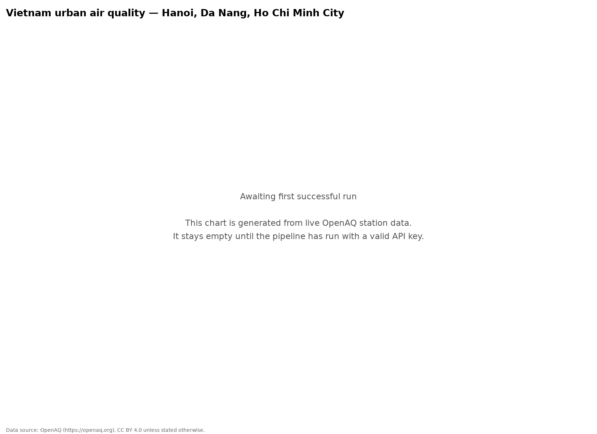

# Air Quality & Weather ETL — Vietnam

Automated hourly air-quality pipeline for **Hanoi**, **Da Nang** and **Ho Chi Minh
City**. A GitHub Action runs it twice a day, pulls real measurements from OpenAQ
stations and meteorological data from Open-Meteo, applies QA/QC rules, benchmarks
the result against **QCVN 05:2023/BTNMT** and **WHO 2021**, stores it as Parquet
read by **DuckDB**, and refreshes the chart below. No local machine involved.



> The chart is generated by the pipeline from live OpenAQ station data. Until the
> first workflow run completes with a valid `OPENAQ_API_KEY`, it renders the
> empty state above rather than placeholder numbers — this repository does not
> commit fabricated measurements to stand in for real ones.

---

## Why this exists

Open environmental data is not clean data. A station that has lost its inlet
keeps reporting; it just reports the same number forever. A telemetry glitch
lands a `-3` in a column of concentrations. A station goes dark for six hours and
the API simply omits those rows, so a naive load looks perfectly healthy.
Comparing that data to a legal limit without handling any of it produces
confident numbers that are wrong.

This pipeline treats those failure modes as the problem, not as noise to
tolerate.

## What it does

| Stage | Detail |
|---|---|
| **Extract** | OpenAQ v3 `/v3/locations` within 25 km of each city centre, then `/v3/sensors/{id}/hours` per sensor, for PM2.5, PM10, NO2 and O3. Open-Meteo supplies temperature, humidity, wind and precipitation. |
| **Normalise** | Units harmonised to µg/m³ at 25 °C / 1 atm, the reference state QCVN uses. ppm and ppb are converted by molar mass; an unrecognised unit becomes null instead of being assumed. |
| **Align** | OpenAQ timestamps are time-**ending**; Open-Meteo's are time-**starting**. Everything is re-keyed to the UTC hour start before any join. |
| **QA/QC** | Five rules per reading, flags stored alongside the value — no row is silently dropped. |
| **Benchmark** | 24 h means compared to QCVN 05:2023 and WHO 2021, with the limit resolved per date. |
| **Load** | Parquet, partitioned `city=<key>/part-<YYYY-MM>.parquet`, zstd. Upserts on `(city, station_id, parameter, hour_utc)`, so a re-run is idempotent. |
| **Report** | DuckDB SQL over the Parquet files produces daily means, per-station anomaly rates and exceedance counts. |

## QA/QC rules

Each rule is a boolean column on every row.

| Flag | Rule | Action on the value |
|---|---|---|
| `qc_negative` | value < 0 | nulled |
| `qc_impossible` | above a per-parameter ceiling (PM2.5 1000, PM10 2000, NO2 2000, O3 1000 µg/m³) | nulled |
| `qc_stuck` | ≥ 6 consecutive identical values (to 2 dp) on one sensor | nulled |
| `qc_spike` | > 5× the centred 24 h median **and** > 100 µg/m³ | **kept** |
| `qc_missing` | hour absent from the expected hourly spine | nulled |

Two decisions are deliberate and worth defending:

**Stuck is detected by rebuilding the expected spine.** OpenAQ returns only the
hours it has. Without an explicit spine, a six-hour outage and a clean six hours
are indistinguishable, so `qc_missing` would always be zero and
misleadingly optimistic.

**Spikes are flagged but never discarded.** A spike rule that deletes its hits
removes exactly the dust episodes and burn-season peaks this project exists to
show. The absolute 100 µg/m³ floor keeps a quiet sensor — median 3 µg/m³ — from
having every ordinary 20 µg/m³ hour labelled anomalous. Below that floor the
relative test alone would fire constantly.

## Benchmarks

24-hour means, µg/m³.

| Pollutant | QCVN 05:2023 24 h | WHO 2021 24 h |
|---|---|---|
| PM2.5 | 50 (45 from 2026-01-01) | 15 |
| PM10 | 100 | 45 |
| NO2 | 100 | 25 |
| O3 | not regulated (1 h 200, 8 h 120) | 100 (8 h) |

**A note on the PM2.5 limit.** QCVN 05:2023/BTNMT Table 1 prints the PM2.5 24 h
value as `50` with an asterisked `45` applying from 01/01/2026. This pipeline
treats **45 as in force** from that date and applies 50 before it. Vietnam's
regulation remains the looser of the two references by a wide margin: 45 against
WHO's 15.

## Output

```
data/
  curated/city=hanoi/part-2026-11.parquet     # one row per station/parameter/hour
  weather/city=hanoi/part-2026-11.parquet
  reports/daily.parquet                       # 30-day daily means
  reports/station_qc.parquet                  # anomaly rate per station
  reports/exceedance.parquet                  # days over QCVN / WHO
charts/aq-30d.png
```

These directories are empty in a fresh clone. The workflow populates and commits
them; nothing here is hand-written or seeded with placeholder rows.

Query it directly:

```bash
uv run python -c "
import duckdb
print(duckdb.sql('''
  select city, parameter, round(avg(value_clean),1) as mean_ugm3, count(*) as hours
  from read_parquet('data/curated/*/*.parquet')
  where hour_utc >= now() - interval 7 day
  group by all order by mean_ugm3 desc
'''))
"
```

## Run locally

```bash
uv sync
export OPENAQ_API_KEY=...          # free: https://explore.openaq.org/register
uv run python -m aqetl run --since 2026-10-16
uv run python -m aqetl report      # rebuild reports + chart, no API calls
uv run pytest -q
```

A 30-day backfill for three cities is a few hundred requests, comfortably inside
OpenAQ's free tier of 2000 requests/hour.

## Testing

```bash
uv run pytest -q       # 53 tests
```

The unit tests pin the boundaries that are easy to get quietly wrong: stuck
detection fires at exactly 6 identical values and not 5, the spike rule needs
both its relative and absolute condition, the QCVN PM2.5 limit switches from 50
to 45 on 2026-01-01, and an OpenAQ time-ending stamp lands in the same UTC hour
as an Open-Meteo local stamp.

`tests/test_pipeline.py` runs the whole pipeline against a mocked OpenAQ
transport — real extract, conversion, gap filling, QA/QC, Parquet upsert, DuckDB
report and chart — so the integration is exercised in CI without a live key. Its
fixture data is synthetic and written to a temp directory, never to `data/`.

## Automation

`.github/workflows/etl.yml` runs at **01:00 and 13:00 UTC** (08:00 and 20:00
ICT). It lints, then **runs the tests before the pipeline** — a broken QA/QC rule
must not be able to commit plausible-looking bad numbers — then fetches a rolling
90-day window, writes Parquet, rebuilds the chart and commits only if something
actually changed.

Add the key as a repository secret:

```bash
gh secret set OPENAQ_API_KEY --repo lastnight030506/air-quality-etl
```

## Attribution

Air quality data: [OpenAQ](https://openaq.org), aggregated from government and
research monitoring networks; per-station licence and provider are preserved in
the `station_name`/`station_id` columns and on OpenAQ itself. Meteorological data:
[Open-Meteo](https://open-meteo.com) (CC BY 4.0), derived from ERA5.

## Limitations

- **Station coverage is uneven.** OpenAQ aggregates volunteer and government
  networks; a city may expose only PM2.5, or nothing at all in a given week. The
  chart shows the stations that reported, and an empty city is stated rather than
  fabricated.
- **Anomaly rate is relative to expected hours**, so a station that is mostly
  offline does not look healthy just because the rows it did send were fine.
- **QCVN 24 h PM2.5 remained 50 µg/m³ until 2026-01-01**; runs over older data
  use the older limit. This only matters for backfills.
- The QA/QC thresholds are engineering judgement calibrated to this dataset, not
  provisions of either standard.
